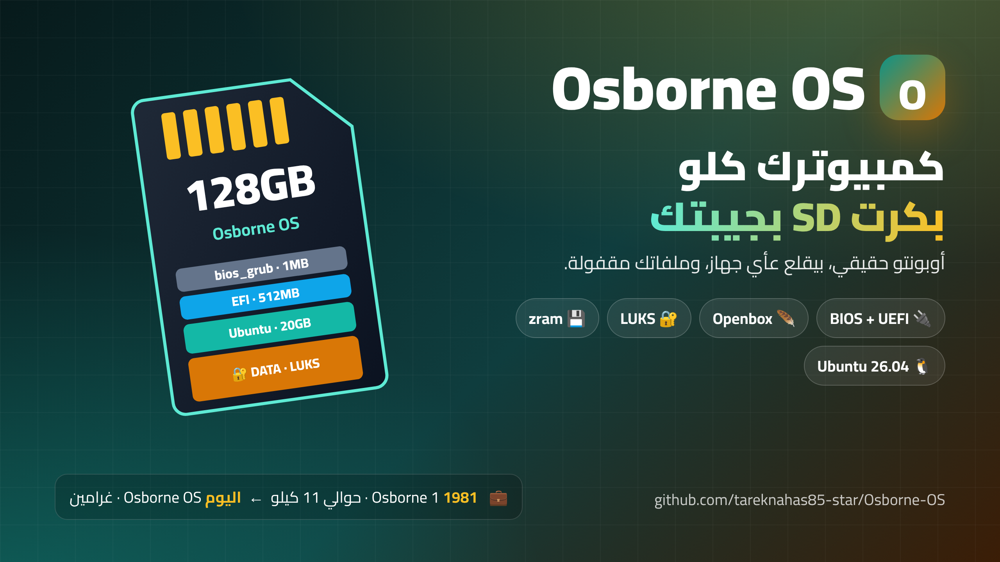

<h1 align="center">Osborne OS</h1>

  <b>Your whole computer on an SD card, in your pocket</b> 
  <b>كمبيوترك كلو بكرت SD بجيبتك</b>

> **ليش اسمو Osborne؟** سنة 1981 طلع **Osborne 1**، أول كمبيوتر محمول نجح بالسوق. وزنو كان حوالي 11 كيلو، شاشتو صغيرة 5 إنش، وكانو يحملوه متل الشنطة. بس فكرتو كانت كبيرة: كمبيوترك معك وين ما رحت.
>
> **وشو علاقتنا فيه؟** نفس الحلم، بس صار أخف بكتير. **Osborne OS** هو أوبونتو حقيقي متنصّب عكرت SD حجمو 128 جيجا: بتحطو بأي كمبيوتر تقريباً، بيقلع بنظامك إنت ببرامجك وملفاتك، وملفاتك بقسم مقفول بكلمة سر. يعني كمبيوترك كلو صار وزنو غرامين وبيفوت بجيبتك.

> **Why "Osborne"?** In 1981 the **Osborne 1** became the first portable computer to sell well. It weighed about 11 kg, had a 5-inch screen, and you carried it like a suitcase, but the idea was big: your computer goes wherever you go. **Osborne OS** keeps that idea and makes it fit in your pocket: a real Ubuntu install on a 128GB SD card that boots on almost any PC, with your files in an encrypted part of the card.

  

  <a href="#english">English</a> &nbsp;·&nbsp; <a href="#arabic">بالعربي</a> &nbsp;·&nbsp; 📘 <a href="https://github.com/tareknahas85-star/Osborne-OS/releases/latest/download/Osborne-OS-Guide.html">Interactive guide · الدليل التفاعلي</a>

## Download · التحميل

| 📘 Guide · الدليل | Setup script · سكربت الإعداد | Autoinstall · التنصيب الآلي | Full guide · الدليل الكامل |
|---|---|---|---|
| [⬇️ Interactive guide · الدليل التفاعلي](https://github.com/tareknahas85-star/Osborne-OS/releases/latest/download/Osborne-OS-Guide.html) | [⬇️ 02-post-install-setup.sh](https://github.com/tareknahas85-star/Osborne-OS/releases/latest/download/02-post-install-setup.sh) | [⬇️ autoinstall-user-data.yaml](https://github.com/tareknahas85-star/Osborne-OS/releases/latest/download/autoinstall-user-data.yaml) | [📄 01-Build-Guide.md](./01-Build-Guide.md) |

📘 **Start here:** the interactive guide is one HTML file that works offline on any device. Download it and open it in any browser.
📘 **ابدأ من هون:** الدليل التفاعلي ملف واحد بيشتغل بلا نت على أي جهاز. نزّلو وافتحو بأي متصفح.

All files and `SHA256SUMS.txt` are on the [releases page](https://github.com/tareknahas85-star/Osborne-OS/releases/latest).
كل الملفات وملف `SHA256SUMS.txt` بـ[صفحة الإصدارات](https://github.com/tareknahas85-star/Osborne-OS/releases/latest).

## Videos · الفيديوهات

🎬 Watch the whole thing on YouTube (made with AI help, Shami voice) · شوف كل شي عاليوتيوب (معمول بمساعدة الذكاء الاصطناعي، وصوت شامي):

- ▶️ [Full walkthrough · الشرح الكامل](https://www.youtube.com/playlist?list=PLKVCo2bD6tZ0)
- 📺 [Step by step · خطوة بخطوة](https://www.youtube.com/playlist?list=PLXL-Sy6MwrZQ)

---

## In English

A guide and scripts to turn a 128GB SD card into a computer you carry in your pocket.

It is a real Ubuntu system on the card, not a live or test copy. You put the card in almost any computer and it starts your own system, with your own files and programs. The desktop is light and fast, and your files are kept in a locked part of the card that nobody can open without your password.

### The files here

- [`01-Build-Guide.md`](./01-Build-Guide.md) is the full guide, step by step
- [`02-post-install-setup.sh`](./02-post-install-setup.sh) is a script you run after the install. It sets up the desktop, the network and the rest
- [`autoinstall-user-data.yaml`](./autoinstall-user-data.yaml) is a ready file that installs the system for you. **It has empty values inside** (`CHANGE_ME_HASH_NOT_PLAINTEXT` and `CHANGE_ME_TEMPORARY_PASSPHRASE`). Put your own values before you use it

### Good to know

- The card is cut into 4 parts, so the system starts on old computers and new ones too
- Your files sit in their own locked part, away from the system part. If you install the system again later, your files stay safe
- Some settings are added to make the card live longer, because SD cards get tired from too much writing

⚠️ **Before you run this on a real computer:** try it first on a test machine or an empty disk. If you pick the wrong disk by mistake, you can erase everything on it.

---

## بالعربي

دليل وسكربتات بتحوّل كرت SD حجمو 128 جيجا لكمبيوتر بتحملو بجيبتك.

هو نظام أوبونتو حقيقي عالكرت، مو نسخة تجريبية مؤقتة. بتحط الكرت بأي كمبيوتر تقريبًا فبيقلع بنظامك أنت، بملفاتك وبرامجك. سطح المكتب خفيف وسريع، وملفاتك محفوظة بقسم مقفول من الكرت ما حدا بيقدر يفتحو بدون كلمة السر.

### الملفات الموجودة هون

- [`01-Build-Guide.md`](./01-Build-Guide.md) هو الدليل الكامل، خطوة خطوة
- [`02-post-install-setup.sh`](./02-post-install-setup.sh) سكربت بتشغّلو بعد التنصيب. بيجهّزلك سطح المكتب والشبكة وباقي الأمور
- [`autoinstall-user-data.yaml`](./autoinstall-user-data.yaml) ملف جاهز بينصّبلك النظام. **جواتو قيم فاضية** (`CHANGE_ME_HASH_NOT_PLAINTEXT` و `CHANGE_ME_TEMPORARY_PASSPHRASE`). حط قيمك الخاصة قبل ما تستخدمو

### شغلات منيح تعرفها

- الكرت مقسوم لـ 4 أقسام، منشان النظام يقلع عالأجهزة القديمة والجديدة سوا
- ملفاتك بقسم مقفول خاص فيها، بعيد عن قسم النظام. وإذا نصّبت النظام من جديد بعدين، ملفاتك بتضل سليمة
- انضافت كم إعدادات منشان الكرت يعيش أطول، لأن كروت SD بتتعب من كتر الكتابة عليها

⚠️ **قبل ما تشغّل هاد عكمبيوتر حقيقي:** جرّبو أول شي عجهاز تجريبي أو قرص فاضي. لأنك إذا اخترت القرص الغلط بالغلط، ممكن تمسح كل شي عليه.

## Contribute · ساهم معنا

Want to help? Read [CONTRIBUTING.md](CONTRIBUTING.md). Issues labelled [`good first issue`](../../labels/good%20first%20issue) are an easy start, and questions or ideas are welcome in [Discussions](../../discussions).

بدك تساعد؟ اقرا [CONTRIBUTING.md](CONTRIBUTING.md). المهام اللي عليها [`good first issue`](../../labels/good%20first%20issue) بداية سهلة، وأي سؤال أو فكرة احكيها بـ [Discussions](../../discussions).
